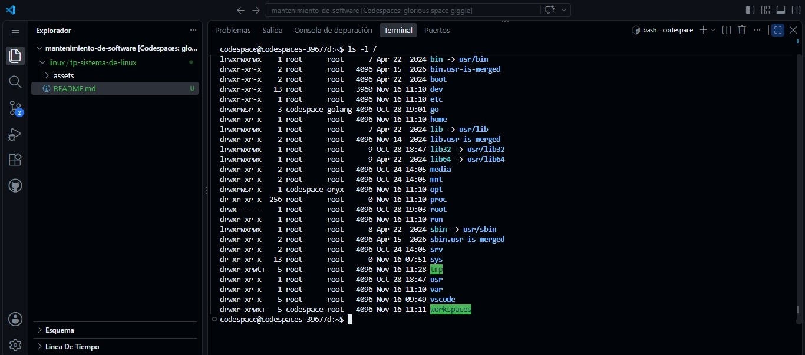
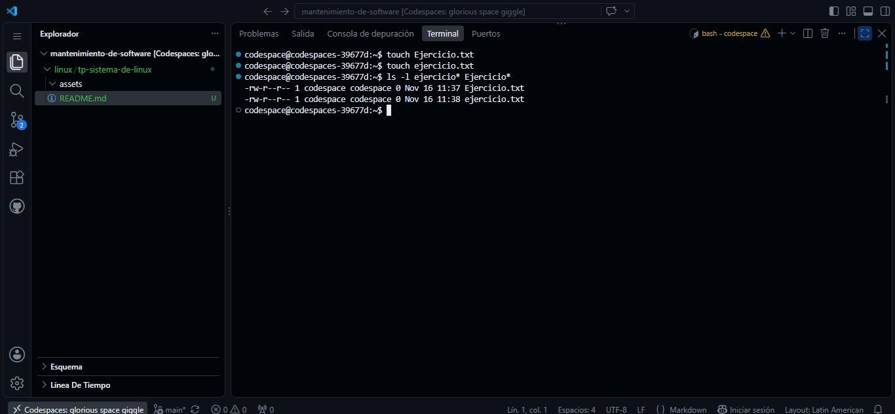
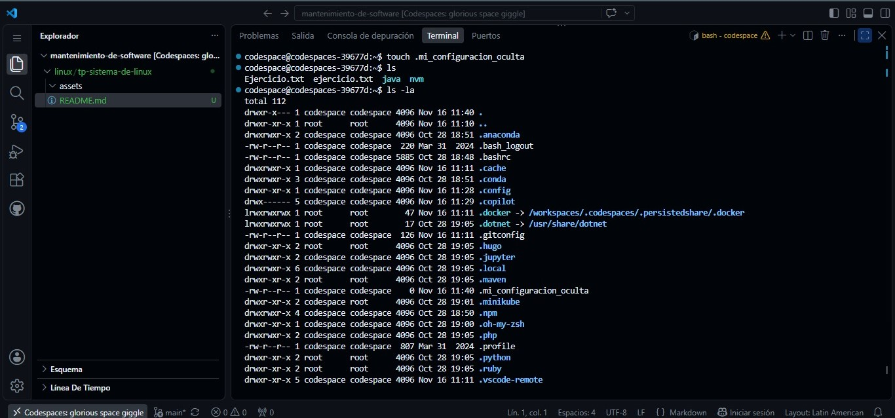
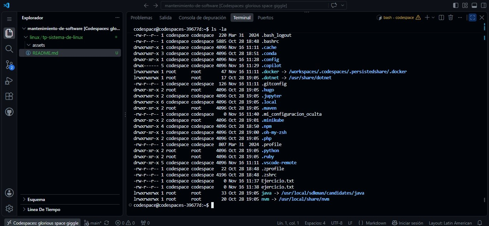
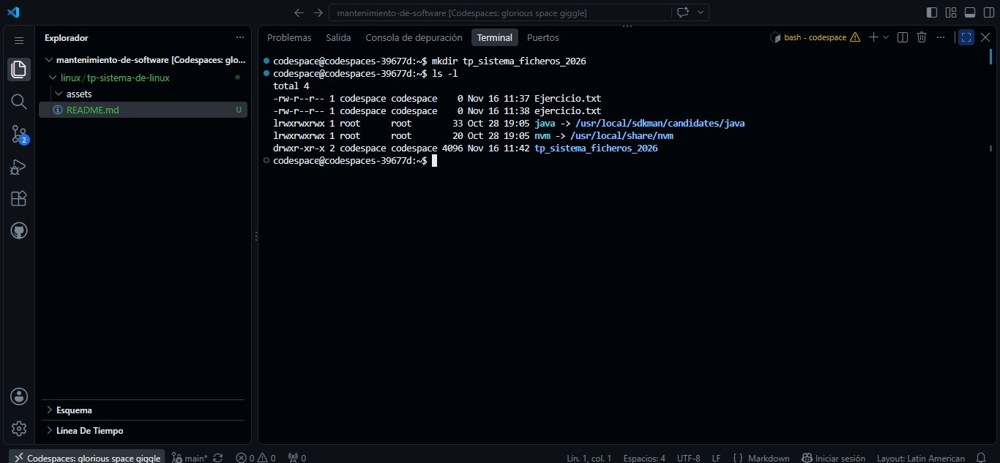
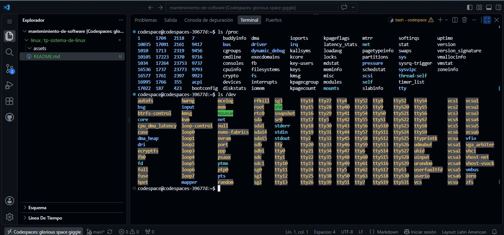

# TP: Sistema de Archivos en Linux

* **Materia:** Mantenimiento de Software
* **Estudiante:** Alan David Chiliguay
* **Fecha de Entrega:** 16/11/2026
* **Profesor:** Gabriel Artaza

---

## 1. Estructura del Árbol de Directorios

Comando ejecutado: `ls -l /`



| Directorio | Función según la guía |
| :--- | :--- |
| `/etc` | Archivos de configuración de la mayoría de los programas. |
| `/home` | Archivos personales de los usuarios. |
| `/dev` | Archivos simbólicos que representan partes del hardware (discos duros, memoria, etc.). |
| `/var` | Datos variables como registros (logs) de programas, bases de datos, contenidos del servidor web y copias de seguridad. |

---

## 2. Sensibilidad a Mayúsculas y Minúsculas

Comandos ejecutados:

```bash
touch Ejercicio.txt
touch ejercicio.txt
ls -l ejercicio* Ejercicio*
```



*Respuesta:* En Linux (como en todos los UNIX) los nombres de archivos distinguen entre mayúsculas y minúsculas, es decir, son *case sensitive*. Por eso `Ejercicio.txt` y `ejercicio.txt` son dos nombres distintos y pueden convivir en la misma carpeta. En Windows, en cambio, los nombres no distinguen mayúsculas de minúsculas, así que ambos serían considerados el mismo archivo y no se podrían crear los dos en la misma carpeta.

---

## 3. Visualización y Gestión de Archivos Ocultos

Comandos ejecutados:

```bash
touch .mi_configuracion_oculta
ls
ls -la
```

 


*Respuesta:* En Linux los archivos y directorios ocultos son los que comienzan con un punto (`.`). El comando `ls` común no los muestra, pero `ls -la` sí. Su utilidad es guardar información de configuración (por ejemplo, la de los programas y el entorno de cada usuario) sin llenar la vista normal de la carpeta, y evitar que se modifiquen o borren por accidente durante el uso cotidiano.

---

## 4. Buenas Prácticas en Nombres de Archivos

Comando ejecutado: `mkdir tp_sistema_ficheros_2026`



*Respuesta:* El nombre `tp_sistema_ficheros_2026` cumple con las recomendaciones de la guía porque usa solamente letras minúsculas (a-z), números (0-9) y guiones bajos (`_`), sin espacios, sin acentos, sin la letra "ñ" y sin signos de puntuación raros.

En cambio, `TP Sistema de Ficheros (Año 2026)!.doc` no las cumple porque tiene:

* **Espacios**, que la guía indica que nunca deben usarse en un nombre de archivo.
* **Caracteres especiales**: paréntesis y signo de exclamación, que no se recomiendan.
* **La letra "ñ"** en "Año", que tampoco se recomienda.
* **Mayúsculas mezcladas**, que en Linux pueden generar confusiones porque se distinguen de las minúsculas.

---

## 5. Exploración de Dispositivos y Procesos

Comandos ejecutados:

```bash
ls /proc
ls /dev
```



*Respuesta:* El directorio `/proc` almacena información temporal sobre los procesos del sistema que están en ejecución. Se trata de un directorio especial donde Linux muestra su estado interno como si fueran archivos (por ejemplo, hay una carpeta numerada por cada proceso activo). Por su parte, `/dev` contiene archivos simbólicos que representan partes del hardware, como discos duros y memoria.
