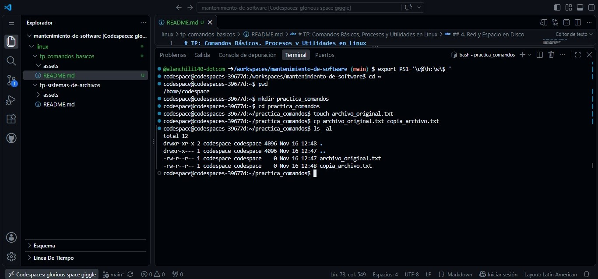
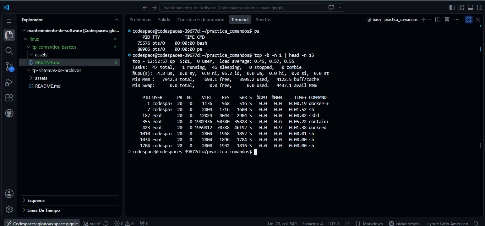
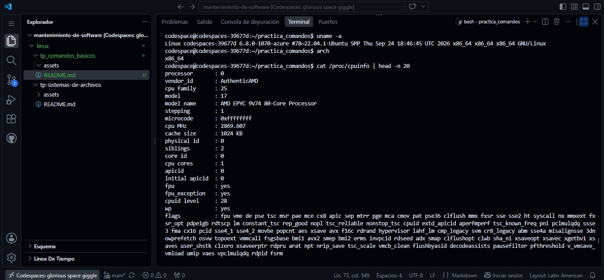
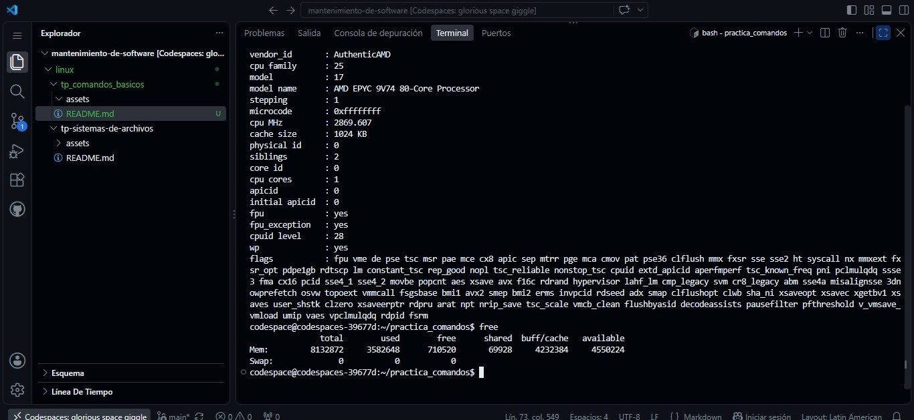
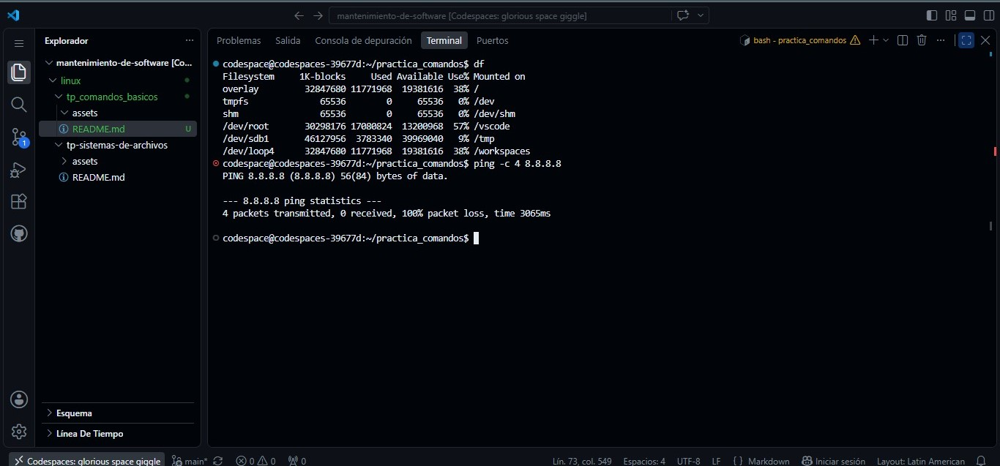

# TP: Comandos Básicos, Procesos y Utilidades en Linux

* **Materia:** Mantenimiento de Software
* **Estudiante:** Alan David Chiliguay
* **Fecha de Entrega:** 16/11/2026
* **Profesor:** Gabriel Artaza

---

## 1. Gestión de Archivos y Directorios

Comandos ejecutados:

```bash
pwd
mkdir practica_comandos
cd practica_comandos
touch archivo_original.txt
cp archivo_original.txt copia_archivo.txt
ls -al
```



* **Explicación de `ls -al`:** El comando `ls` simple solo lista los nombres de los archivos y carpetas del directorio actual, y no muestra los ocultos (los que empiezan con un punto). Con la opción `-al` se combinan dos cosas: `-a` (*all*) incluye también los archivos y directorios ocultos, como `.` y `..`, y `-l` (*long*) muestra el listado en formato largo, con permisos, propietario, grupo, tamaño y fecha de modificación de cada elemento.

---

## 2. Monitoreo de Procesos

Comandos ejecutados:

```bash
ps
top
```



* **Diferencia entre `ps` y `top`:** El comando `ps` sin opciones muestra una "foto" estática, en una tabla, de los procesos propios del usuario en el momento en que se ejecuta, y después termina. En cambio, `top` es una herramienta interactiva que muestra en tiempo real todos los procesos en funcionamiento y se va actualizando continuamente; se puede pulsar `h` para ver la ayuda y `q` para salir.
* **Uso de `kill`:** El comando `kill pid` se usa para terminar un proceso concreto a partir de su PID (el número identificador que se ve con `ps` o `top`). Sirve cuando un programa se cuelga y no se puede cerrar de forma normal: se obtiene su PID y se ejecuta `kill` para eliminarlo.

---

## 3. Información del Sistema

Comandos ejecutados:

```bash
uname -a
arch
cat /proc/cpuinfo
free
```




* **Detalles del Kernel y Memoria:** El comando `uname -a` muestra la información del núcleo (kernel) del sistema operativo: el nombre del kernel, el nombre del equipo, la versión del kernel, la fecha de compilación y la arquitectura del hardware. Por su parte, `free` muestra el uso de la memoria del sistema: cuánta memoria RAM hay en total, cuánta está usada y cuánta libre, y también el uso de la memoria SWAP. Además, `arch` indica la arquitectura (por ejemplo x86 o ARM) y `cat /proc/cpuinfo` muestra información de la CPU.

---

## 4. Red y Espacio en Disco

Comandos ejecutados:

```bash
df
ping -c 4 8.8.8.8
```



* **Funcionamiento de `ping`:** El objetivo principal de `ping` es comprobar que las funciones básicas de una red TCP/IP funcionan correctamente. La herramienta envía a otro equipo un pequeño paquete de datos y le ordena que, una vez recibido, lo devuelva de inmediato. Si la respuesta llega, `ping` lo indica con un mensaje, con lo que se asegura que existe la capacidad de transmisión básica entre ambos equipos. En este caso, la opción `-c 4` limita el envío a 4 paquetes. Por otro lado, `df` muestra el espacio usado y disponible en los discos.