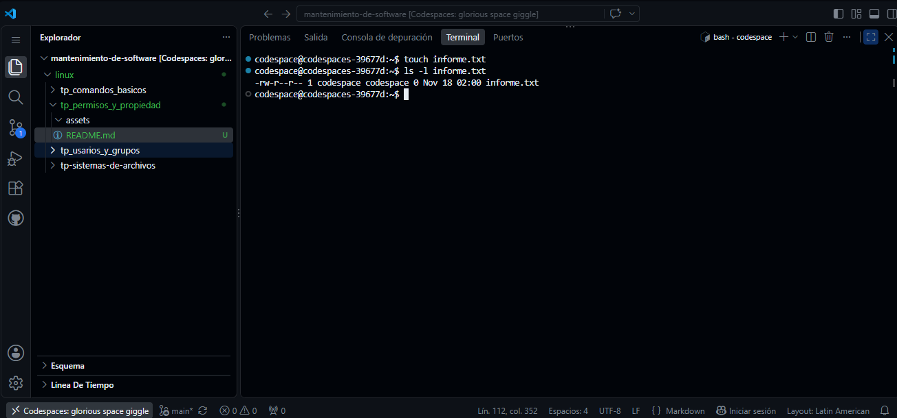
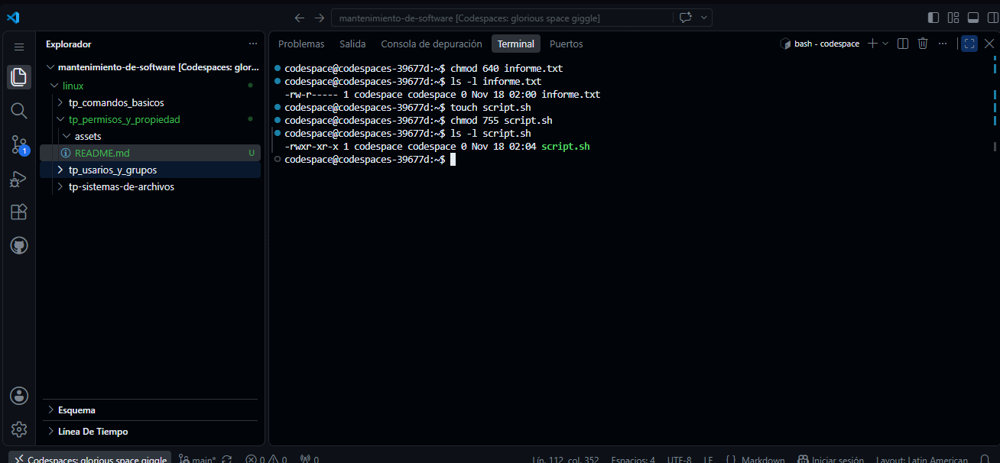
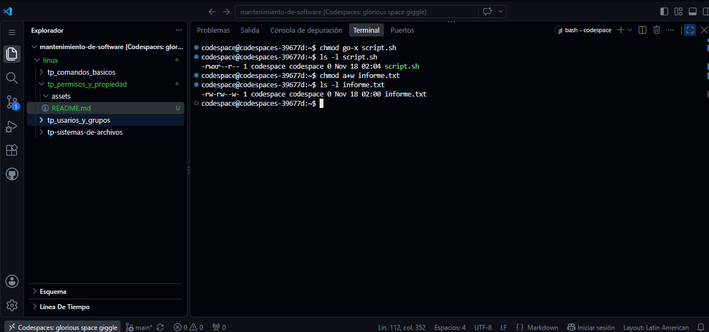
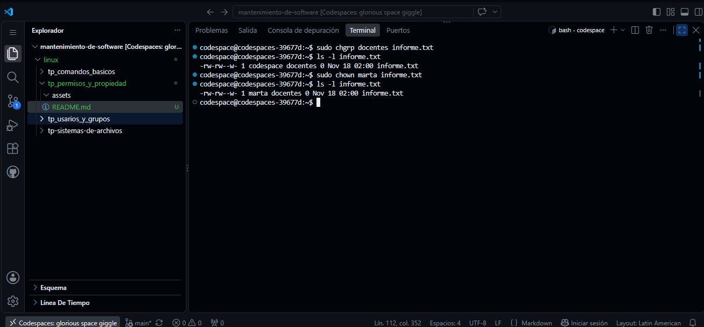
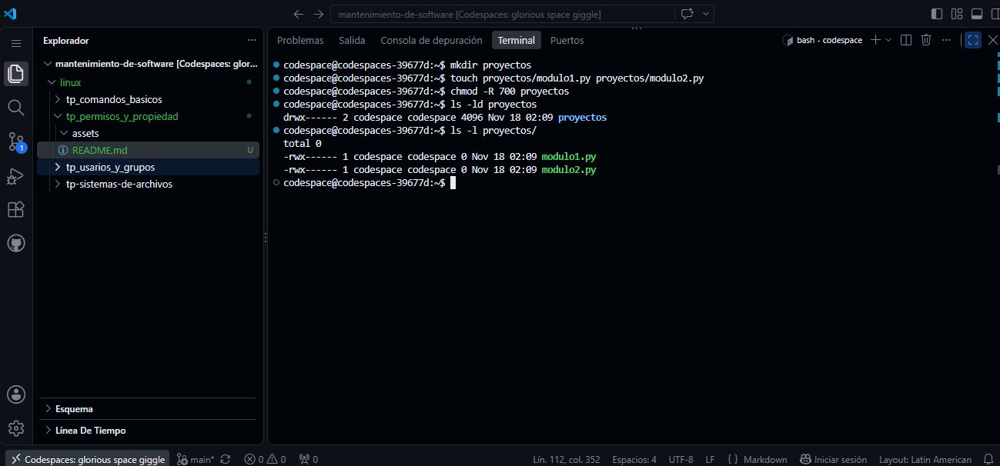

# TP: Permisos de Archivos, Directorios y Propiedad en Linux

* **Materia:** Mantenimiento de Software
* **Estudiante:** Alan David Chiliguay
* **Fecha de Entrega:** 17/11/2026
* **Profesor:** Gabriel Artaza

---

## 1. Lectura e Interpretación de Permisos (`ls -l`)

Comandos ejecutados:

```bash
touch informe.txt
ls -l informe.txt
```



El primer carácter indica el **tipo de elemento**, y los 9 caracteres siguientes se dividen en tres grupos de tres: propietario, grupo y otros.

| Posición | Representación | Significado / Permiso |
| :--- | :--- | :--- |
| Tipo | `-` / `d` / `l` | `-` es un archivo común, `d` es un directorio (carpeta) y `l` es un enlace simbólico. |
| Propietario (`u`) | `rwx` | Permisos del dueño del archivo (*user*). |
| Grupo (`g`) | `rwx` | Permisos de los usuarios que pertenecen al grupo del archivo (*group*). |
| Otros (`o`) | `rwx` | Permisos de todos los demás usuarios del sistema (*others*). |

Significado de cada letra:

* **`r` (lectura):** permite ver el contenido de un archivo; en un directorio, permite listar lo que contiene.
* **`w` (escritura):** permite modificar el archivo; en un directorio, permite crear, borrar o renombrar elementos dentro.
* **`x` (ejecución):** permite ejecutar el archivo como programa o script; en un directorio, permite entrar en él.
* **`-`:** indica que ese permiso no está concedido.

Por ejemplo, `-rw-r--r--` es un archivo común donde el propietario puede leer y escribir, y el grupo y otros solo pueden leer.

---

## 2. Permisos en Modo Octal

Comandos ejecutados:

```bash
chmod 640 informe.txt
ls -l informe.txt
touch script.sh
chmod 755 script.sh
ls -l script.sh
```



Cada permiso vale un número: lectura (`r`) = 4, escritura (`w`) = 2 y ejecución (`x`) = 1. Para cada nivel se suman los valores de los permisos concedidos.

* **Desglose numérico 640:** propietario `r(4)+w(2) = 6` | grupo `r(4) = 4` | otros `- = 0`. Resultado: `rw-r-----`.
* **Desglose numérico 755:** propietario `r(4)+w(2)+x(1) = 7` | grupo `r(4)+x(1) = 5` | otros `r(4)+x(1) = 5`. Resultado: `rwxr-xr-x`.

---

## 3. Modo Simbólico

Comandos ejecutados:

```bash
chmod go-x script.sh
ls -l script.sh
chmod a+w informe.txt
ls -l informe.txt
```



* **Ventaja del modo simbólico:** Permite modificar solamente un permiso puntual sin tocar los demás y sin tener que calcular el número completo. Por ejemplo, `chmod go-x script.sh` quita la ejecución al grupo y a otros, y deja todo lo demás igual. Con el modo octal habría que conocer los permisos actuales y escribir los tres dígitos de nuevo, con el riesgo de sobrescribir algo por error. Además, es más fácil de leer: `u` (usuario), `g` (grupo), `o` (otros) y `a` (todos), con `+` para agregar y `-` para quitar.

---

## 4. Cambio de Propietario y Grupo

Comandos ejecutados:

```bash
sudo chgrp docentes informe.txt
ls -l informe.txt
sudo chown marta informe.txt
ls -l informe.txt
```



* **¿Por qué se requiere privilegio superusuario para `chown`?:** Porque cambiar el propietario de un archivo es una acción administrativa que afecta a la seguridad y al control del sistema. Si cualquier usuario pudiera cederle sus archivos a otro, podría eludir los controles que tiene el administrador sobre quién es responsable de cada archivo. Por eso solo el usuario `root` (o un usuario que use `sudo`) puede cambiar el propietario.

---

## 5. Permisos Recursivos en Directorios

Comandos ejecutados:

```bash
mkdir proyectos
touch proyectos/modulo1.py proyectos/modulo2.py
chmod -R 700 proyectos
ls -ld proyectos
ls -l proyectos/
```



La opción `-R` aplica el cambio de permisos a la carpeta indicada, a sus subdirectorios y a todos los archivos que contienen. En este caso `700` deja `rwx` solo para el propietario y ningún permiso para el grupo ni para otros.

* **Importancia del permiso `x` en un directorio:** En un directorio, el permiso de ejecución (`x`) permite **entrar** en él (por ejemplo con `cd`) y acceder a los elementos que contiene. Si se le quita, ese usuario ya no puede entrar al directorio ni acceder a su contenido, aunque tenga permiso de lectura para ver los nombres de lo que hay adentro.