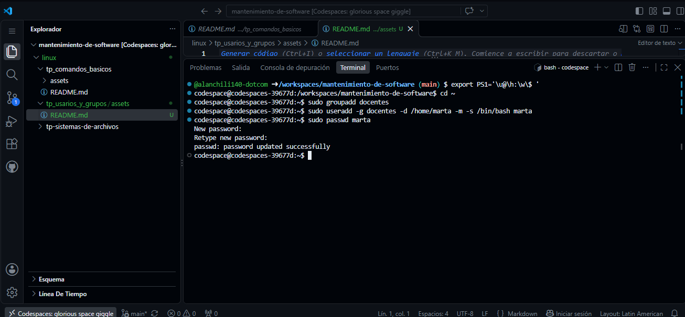
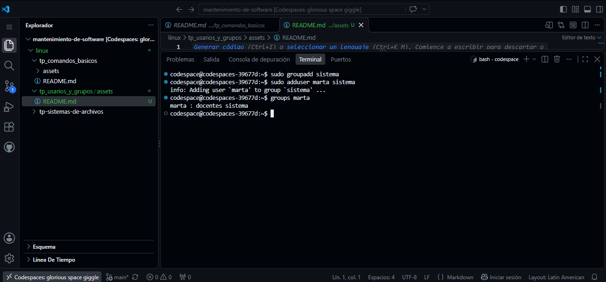
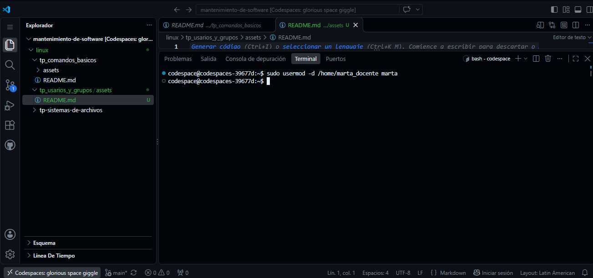
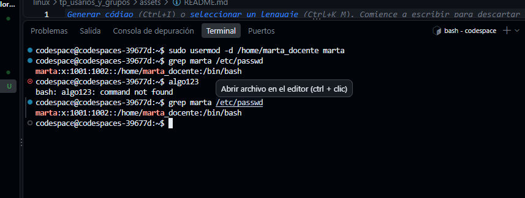
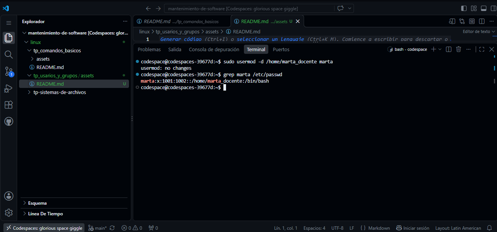
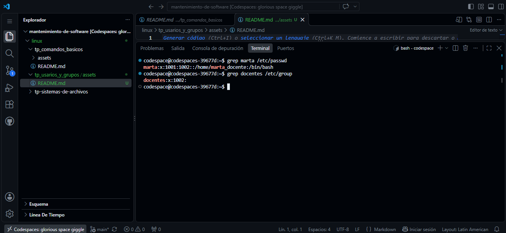
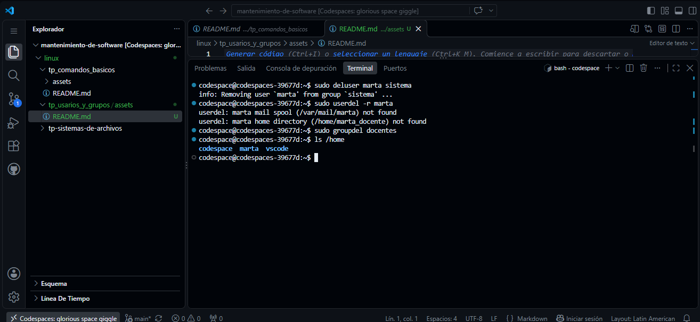

# TP: Administración de Usuarios y Grupos en Linux
 
* **Materia:** Mantenimiento de Software
* **Estudiante:** Alan David Chiliguay
* **Fecha de Entrega:** 16/11/2026
* **Profesor:** Gabriel Artaza
---
 
## 1. Creación de Grupos y Usuarios
 
Comandos ejecutados:
 
```bash
sudo groupadd docentes
sudo useradd -g docentes -d /home/marta -m -s /bin/bash marta
sudo passwd marta
```
 

 
* **Explicación del parámetro `-m`:** La opción `-m` le indica a `useradd` que cree la carpeta home del usuario si no existe. Si se omite, el usuario se crea igual pero su carpeta personal no se genera, y habría que crearla manualmente.
---
 
## 2. Gestión de Grupos Secundarios
 
Comandos ejecutados:
 
```bash
sudo groupadd sistema
sudo adduser marta sistema
groups marta
```
 

 
* **Comando para quitar usuario de un grupo:** Se usa `deluser` seguido del nombre del usuario y del grupo, por ejemplo: `sudo deluser marta sistema`.
---
 
## 3. Modificación de Usuarios
 
Comando ejecutado:
 
```bash
sudo usermod -d /home/marta_docente marta
grep marta /etc/passwd
```
 



 
* **Diferencia entre `useradd` y `usermod`:** El comando `useradd` sirve para **crear** un usuario nuevo, indicando en la misma línea sus datos (grupo, home, shell, etc.). En cambio, `usermod` se usa para **modificar** un usuario que ya existe, por ejemplo cambiar su carpeta home, su shell o los grupos a los que pertenece.
---
 
## 4. Ficheros de Configuración
 
Comandos ejecutados:
 
```bash
grep marta /etc/passwd
grep docentes /etc/group
```
 

 
| Fichero | Contenido / Función |
| :--- | :--- |
| `/etc/passwd` | Información de cada usuario: nombre, directorio home, intérprete de comandos (shell), etc. |
| `/etc/group` | Información sobre los grupos de usuarios. |
| `/etc/shadow` | Contraseñas encriptadas de los usuarios y la configuración de su validez, cambio, etc. |
 
---
 
## 5. Eliminación de Usuarios y Grupos
 
Comandos ejecutados:
 
```bash
sudo deluser marta sistema
sudo userdel -r marta
sudo groupdel docentes
```
 

 
* **Uso del parámetro `-r` en `userdel`:** La opción `-r` hace que, además de eliminar el usuario, se elimine también su carpeta home. Sin esa opción, el usuario se borra pero su carpeta personal queda en el sistema.
* **Condición para borrar un grupo con `groupdel`:** Para poder eliminar un grupo, ningún usuario debe tenerlo como grupo primario. Si algún usuario lo tiene como grupo primario, `groupdel` no lo elimina.
 